# WebGPU Forward+ and Clustered Deferred Shading

**University of Pennsylvania · CIS 565: GPU Programming and Architecture · Project 4**

**Qingyao Tian** · [Repository](https://github.com/LetTucee-T/Project4-WebGPU-Forward-Plus-and-Clustered-Deferred) · [Project website — GitHub Pages](https://lettucee-t.github.io/Project4-WebGPU-Forward-Plus-and-Clustered-Deferred/)

A WebGPU renderer for the supplied Sponza scene with up to **5,000 animated point lights**. This project compares naive forward shading, Forward+, and clustered deferred shading, then explores depth prepasses, visibility-aware clustering, and smaller G-buffers. Baseline and optimized paths remain selectable so their output and cost can be compared under the same scene settings.

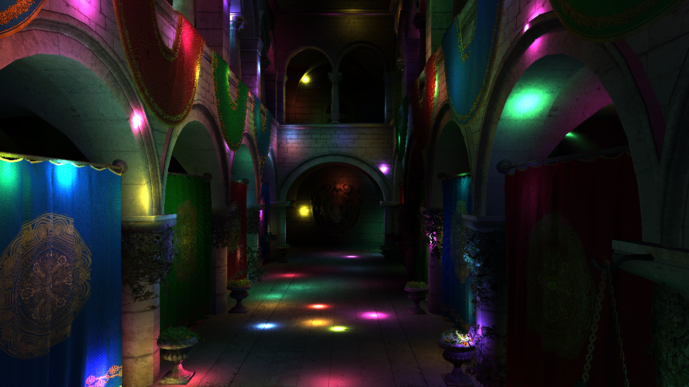

*1280 × 720, Atrium camera, 1,000 lights, seed 123456789, light time 2,500 ms; 8 B color G-buffer plus 4 B sampled depth.*

## Demo

[Watch or download the 50-second walkthrough (WebM, 720p)](docs/demo/demo.webm) · [Chapter-based video player](docs/demo/index.html)

The walkthrough shows all three renderers, Forward+ depth prepass, depth-based cluster culling, light-position precomputation, all four deferred variants, 5,000 moving lights, camera movement/presets, and benchmark controls. English captions explain each step. The recording demonstrates the features; GPU performance is measured separately below. To use the chapter player, run the application and open `docs/demo/` under the server URL printed by Vite. The production build includes the same player and media.

## Implemented features

| Feature | Implementation |
| --- | --- |
| Camera and naive renderer | Camera uniforms, model/view/projection transforms, interactive movement, and the supplied all-lights shading baseline. |
| Forward+ | GPU sphere/AABB intersection tests build per-cluster light lists; fragments iterate only their cluster's lights. |
| Clustered deferred | Shared clustering, geometry pass to a G-buffer, and separate lighting over visible pixels. |
| Light-position precomputation | Optional compute pass transforms each active light into view space once per frame. |
| Forward+ depth prepass | Alpha-tested depth pass followed by depth-equal lighting; stencil avoids duplicate shading of equal-depth coverage. |
| Depth-based cluster culling | Separate fullscreen-quad pass marks potentially visible clusters; inactive cluster invocations reset their count and return early. |
| Compute deferred lighting | One compute pass replaces fullscreen raster lighting and writes directly to the canvas. |
| G-buffer packing | Selectable 16 B and 8 B color layouts with octahedral normals and reconstructed positions. |
| Measurement tools | GPU timestamp queries, fixed scene controls, automated benchmark suites, repeated rounds, cancellation, and JSON/CSV exports. |

The extra-credit implementation covers **Depth Prepass for Forward+ (5 + 10 points)** and **G-buffer Optimization (5 + 5 points)**. Both packed layouts are available as alternatives within the G-buffer optimization.

## Run locally

Requirements: **Node.js 22.12 or newer in the Node 22 release line**, npm, and a WebGPU-capable browser with hardware acceleration. Scene assets are included in the repository.

The recorded tests used Chrome **155.0.8059.79** on Windows x64, an Intel Core i7-14650HX, approximately 32 GB RAM, and a WebGPU adapter reporting **NVIDIA / Lovelace**. The exact GPU model was not exposed by the browser.

```sh
git clone https://github.com/LetTucee-T/Project4-WebGPU-Forward-Plus-and-Clustered-Deferred.git
cd Project4-WebGPU-Forward-Plus-and-Clustered-Deferred
npm ci
npm run dev
```

Open the local URL printed by Vite. For static validation and a production build:

```sh
npm run typecheck
npm run check:docs
npm run build
npm run preview
```

The documentation check verifies included local references, scene assets, and publication text. The GitHub Actions workflow runs both checks before building. The build includes the scene, figures, and demonstration player in `dist/`. Use the server URL printed by Vite so the instructions also work when its default port is occupied. GPU timing uses optional `timestamp-query`; rendering remains available on adapters without it. Compute output uses `rgba8unorm` when optional BGRA storage support is unavailable.

| Control | Action |
| --- | --- |
| W / A / S / D | Move the camera forward / left / backward / right. |
| Q / E | Move down / up along the camera's up direction. |
| Hold the mouse button over the scene and move | Look around; release to leave pointer lock. |
| Shift / Alt | Move faster / slower. |
| Renderer | Select naive, forwardPlus, or clusteredDeferred. |
| Scene | Pause lights, set seed/time, choose Atrium/Wall/Sky, and set physical rendering resolution. |
| Reset fixed scene | Restore the selected camera, regenerate the current seed's lights, and pause light time at 2,500 ms. |
| Performance | Toggle light precomputation, Forward+ depth options, GPU timing, rendering pause, and deferred layout. |
| Benchmark | Select a suite, run/cancel, and export measurements. |

Enabling **Depth cluster culling** also enables the depth prepass. These switches affect Forward+; **Deferred pipeline** affects clustered deferred. Pause **lights** to compare images at a fixed time; pause **rendering** to stop this tab's GPU submissions. The deferred default remains Raster for a clear baseline.

## Rendering design

### Shared clustering

The view frustum is divided into **16 × 9 × 24 = 3,456 clusters**, with uniform XY tiles and logarithmic depth slices. One compute invocation owns one cluster. It reconstructs the cluster's view-space bounds, scans the active point lights, and appends intersecting sphere indices to that cluster's list. The same indexing functions are used by clustering and lighting.

Lists store a count and capacity for all 5,000 lights, avoiding truncation in the supported workload. This simple layout uses **69,133,824 bytes** for cluster lists. It is intentionally conservative rather than memory-optimal. The optional light transform pass uses another 80,000 bytes; it removes repeated matrix transforms but does not change the O(clusters × lights) intersection algorithm.

### Forward+ depth pipeline

`depth prepass → optional active-cluster marking → optional light transform → clustering → forward lighting`

The prepass writes depth with `less` and applies the same alpha cutoff as lighting. Lighting uses `equal` with depth writes disabled. Both passes share the invariant vertex position calculation. A stencil test preserves the first surface at equal depth and prevents duplicate coverage from contributing again.

The marking pass reads every valid source depth in each **2 × 2 block**, including odd-resolution edges. It conservatively marks the covered XY/depth range with a small depth tolerance. Flags are cleared on the GPU every frame. All cluster invocations are still dispatched; inactive ones write a zero count and return before intersection tests. This implementation uses the inactive-invocation skipping approach. The flag buffer adds 13,824 bytes.

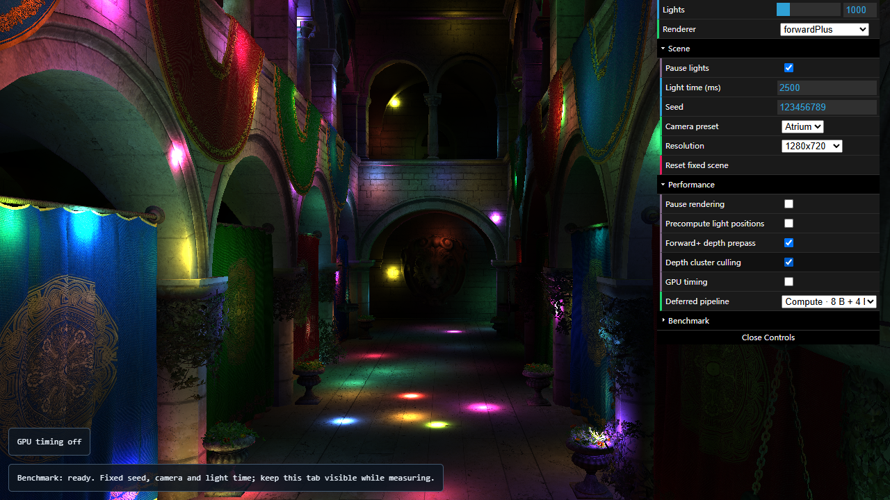

### Deferred layouts

The raster baseline shades a fullscreen primitive. All compute variants use **8 × 8 workgroups**, bounds-check edge invocations, and write the canvas storage texture directly in one lighting pass.

| UI variant | Color attachments | Color bytes/pixel | Data read by lighting |
| --- | --- | ---: | --- |
| Raster · 32 B/pixel | `rgba32float` + 2 × `rgba16float` | 32 | Position, normal, albedo; raster lighting. |
| Compute · 32 B/pixel | Same three attachments | 32 | Same fields; compute lighting. |
| Compute · packed 16 B/pixel | One `rgba32uint` | 16 | f32 linear view depth, oct normal packed into 2 × snorm16, RGB as 3 × f16, one unused f16. |
| Compute · 8 B + 4 B depth | One `rg32uint` | 8 | Oct normal and 3 × 10-bit RGB, plus a sampled `depth32float` texture: **12 B/pixel total lighting input**. |

The 16 B path reconstructs position from linear view depth. The 8 B path reconstructs it from pixel-center coordinates, WebGPU depth, inverse projection, and inverse view. Its RGB is square-root encoded before 10-bit quantization and squared after decoding, improving precision for dark albedo. This is a storage encoding, not a change to the shading color space. It supports LDR albedo in [0, 1]. Alpha testing happens before packing.

Color payload decreases **32 → 16 → 8 B/pixel**. The final path cuts color payload by 75% relative to the baseline; its lighting inputs are 12 B rather than 16 B, a 25% reduction relative to the first packed version. Other variants also allocate a depth attachment, but discard it after geometry. These counts describe format payload, not measured allocation, compressed memory traffic, or total application VRAM.

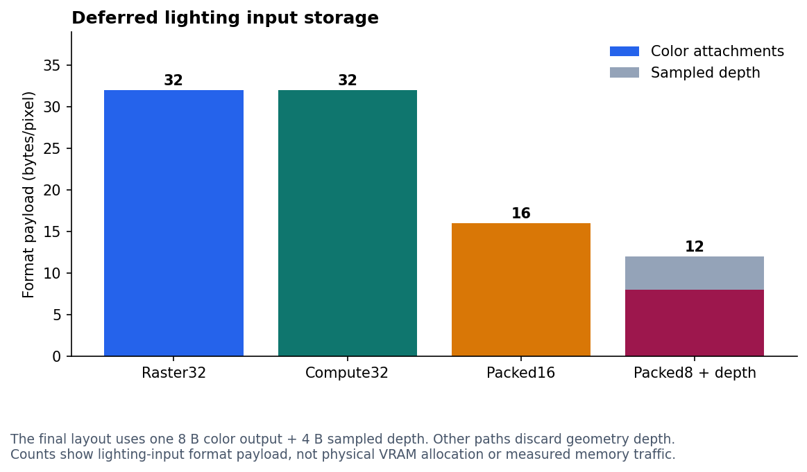

## Performance analysis

### Method and scope

Measurements use hardware WebGPU timestamp queries, a fixed seed of **123456789**, light time **2,500 ms**, DPR 1, and the fixed 16 × 9 × 24 grid. Light counts are 100, 500, 1,000, 2,500, and 5,000; resolution tests use 960 × 540, 1280 × 720, and 1920 × 1080. Atrium, Wall, and Sky are three views of the **same Sponza model**, not three independent scenes. Cluster dimensions remain fixed throughout the experiments.

| Experiment | Configurations | Samples/configuration | Timing used below |
| --- | ---: | ---: | --- |
| Baseline renderers and light transforms | 45 | 3 rounds × 30 | GPU pass sum |
| Depth prepass | 36 | 4 rounds × 30 | GPU pass sum |
| Depth culling, one-pixel marker | 54 | 4 rounds × 30 | GPU span |
| Depth culling, 2 × 2 marker | 54 | 4 rounds × 30 | GPU span |
| Raster, compute, and Packed16 | 54 | 4 rounds × 30 | GPU span |
| All four deferred layouts | 72 | 4 rounds × 30 | GPU span |

Each run warms up for 12 frames. Variant order rotates or alternates across rounds. Additional project previews were paused during the formal measurements. Charts show medians with P10–P90 ranges where provided; those ranges describe sample spread, not confidence intervals.

**GPU pass sum** adds individually timed passes. **GPU span** measures from the first pass's start to the last pass's end, also including gaps and intervening flag clears. Both exclude common light animation, CPU encoding, readback wait, and presentation. CPU encoding is recorded separately. Each benchmark sample awaits its timestamp readback, so these results are **not end-to-end frame times or FPS**. Individual pass medians need not sum to the median total.

Observed timestamp quantization is about **0.065536 ms**; a zero or one-step difference is weak evidence of a real speedup. System activity and GPU scheduling/frequency remain sources of variation. Pipeline comparisons below use variants from the **same experiment**. Absolute times from the baseline and deferred-layout experiments are separate measurements, not a before/after pair.

### Baseline: Forward+ versus clustered deferred

Baseline experiment, 1280 × 720, Atrium, light precomputation off; median **GPU pass sum**:

| Lights | Naive (ms) | Forward+ (ms) | Deferred raster (ms) |
| ---: | ---: | ---: | ---: |
| 100 | 4.129 | 0.459 | 0.590 |
| 500 | 24.183 | 1.835 | 0.852 |
| 1,000 | 49.021 | 3.473 | 1.311 |
| 2,500 | 125.862 | 9.241 | 2.556 |
| 5,000 | 257.098 | 18.874 | 4.489 |

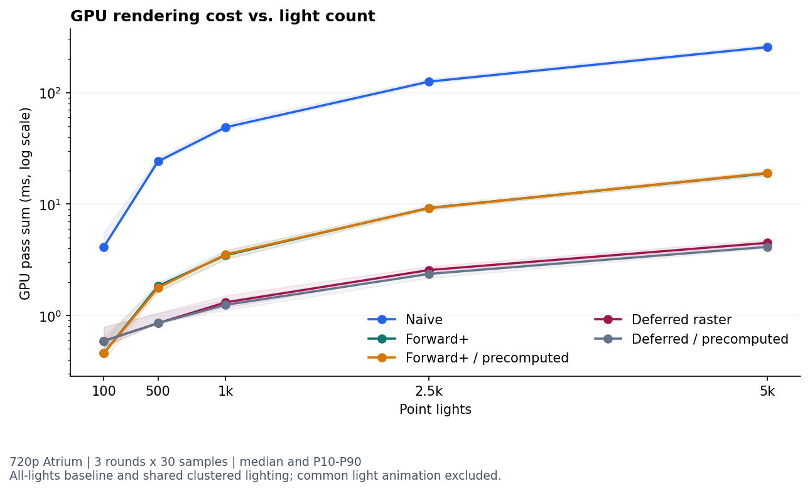

Both clustered methods avoid the naive all-lights loop at each fragment. Forward+ wins at 100 lights, where the extra G-buffer traffic and deferred pass are comparatively expensive. Deferred wins at 500–5,000 lights in this view: moving expensive lighting to visible pixels is consistent with these results, although overdraw was not directly counted in this baseline experiment.

At 1,000 lights, increasing resolution from 540p to 1080p raises Forward+ from 2.294 to 7.111 ms and deferred from 0.852 to 2.687 ms. At 720p, Wall gives 0.262/0.524 ms and Sky 0.262/0.328 ms for Forward+/deferred. Visible geometry, covered pixels, and cluster light density change the balance; deferred is not universally faster.

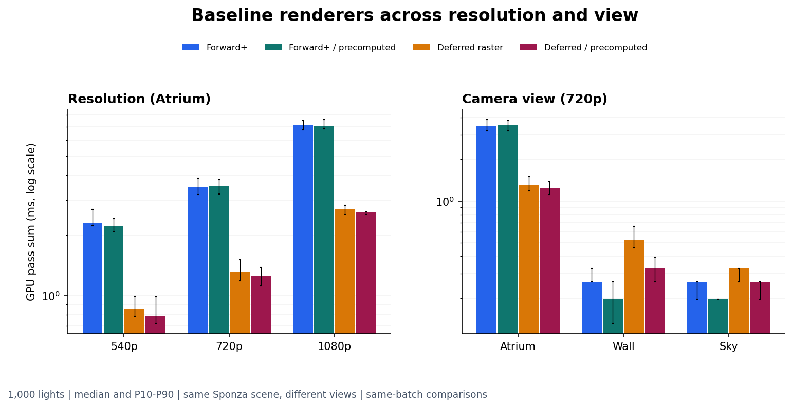

### Optimization: precompute view-space light positions

At 5,000 lights in the baseline experiment, **transform + clustering** decreases from **1.180 to 0.852 ms** for Forward+ and **0.983 to 0.721 ms** for deferred, including the added transform pass. Deferred's total pass sum falls from 4.489 to 4.129 ms, about 8.0%; Forward+'s rises slightly from 18.874 to 19.038 ms. Reducing one stage therefore does not prove that the whole pipeline speeds up.

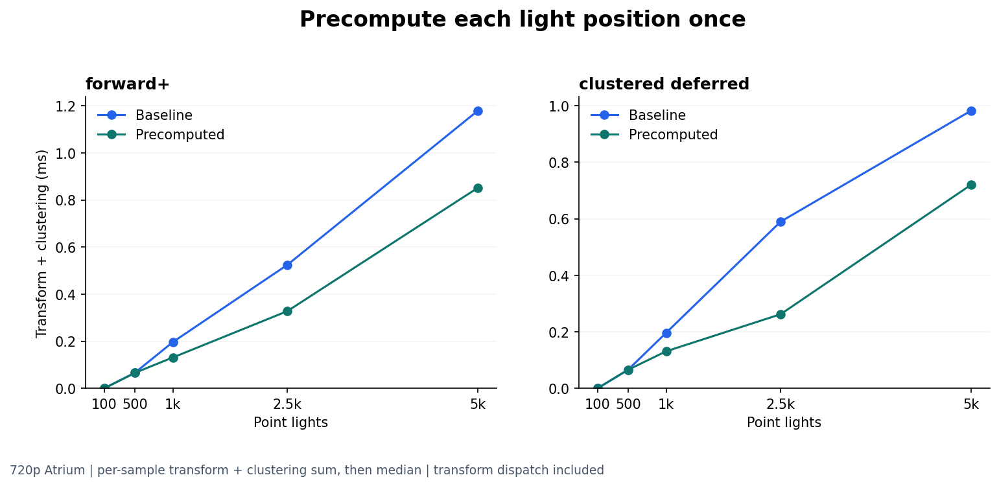

This optimization is most promising when repeated transforms make up a substantial fraction of clustering. At very low light counts the gain falls below timer resolution, while dispatch and buffer traffic remain. Further work could use tighter light bounds or a more parallel assignment algorithm; transforming lights once does not reduce the number of intersection pairs.

### Optimization: depth prepass and active clusters

The depth-culling experiment compares all three Forward+ paths in one batch. The following values are median **GPU span**, 720p Atrium, precomputation off:

| Lights | Forward+ (ms) | + depth prepass (ms) | + active-cluster culling (ms) |
| ---: | ---: | ---: | ---: |
| 100 | 0.590 | 0.721 | 0.786 |
| 500 | 1.901 | 1.573 | 1.638 |
| 1,000 | 3.506 | 2.556 | 2.621 |
| 2,500 | 9.437 | 5.964 | 6.095 |
| 5,000 | 19.497 | 12.386 | 11.895 |

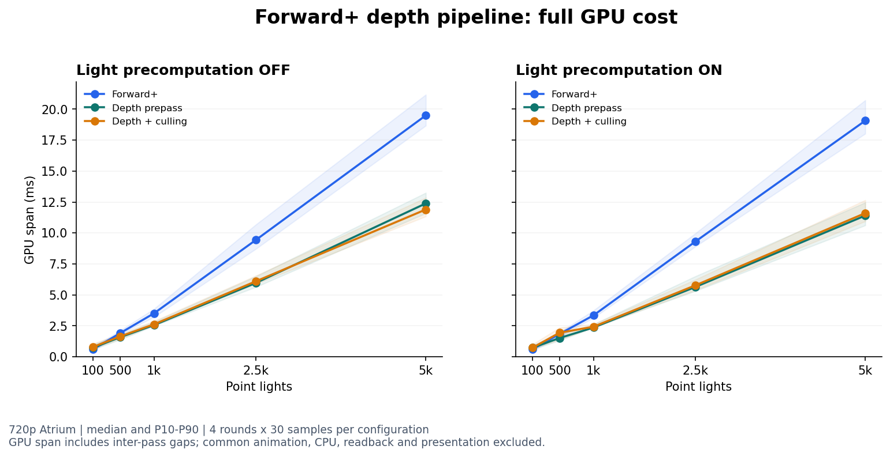

The prepass pays for an extra geometry pass to avoid repeated lighting. Its benefit grows with expensive lighting and overlapping geometry. At 100 lights it costs more than it saves. The isolated depth-prepass experiment also shows this tradeoff: at 1080p/1,000 lights, pass sum decreases from 7.143 to 4.293 ms (39.9%); at 720p/100 lights it increases from 0.459 to 0.655 ms (42.9%). Wall/Sky gains were below what that experiment reliably resolved. These pass sums are separate paired measurements, not interchangeable with the spans above.

Depth marking reduces the potentially active clusters from **3,456 to 294** in fixed Atrium, including 13 conservative extras beyond the 281 actually visible clusters. Wall and Sky mark 158 and 127. The debug view below is read from the real GPU flags.

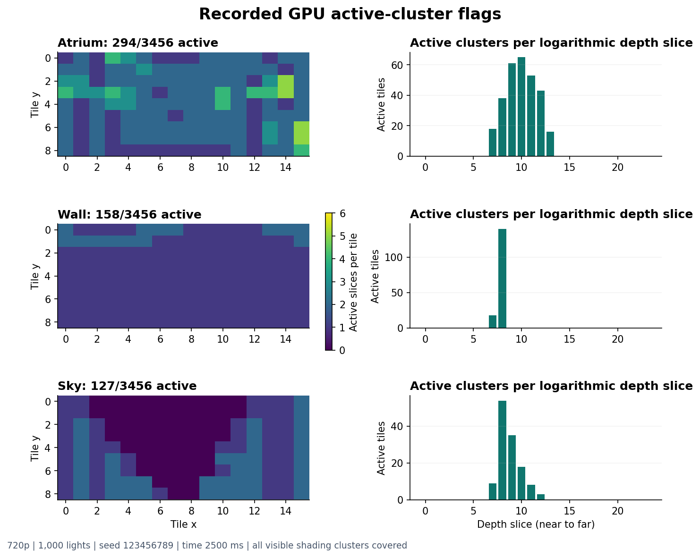

Despite roughly 91.5% fewer tested clusters in Atrium, culling does **not** show a stable overall speedup. At 1,000 lights it adds 0.066 ms to the span; at 5,000 lights the span drops by 4.0%, but clustering's median remains 1.704 ms and most of the difference appears in shading. Because the visible light lists and shading code are unchanged, this is insufficient evidence that skipping clusters caused the full improvement. All invocations are still dispatched; branch distribution, reduced parallelism, latency, and GPU state are plausible explanations, not measured hardware-counter conclusions.

The first marking implementation processed one depth per fragment. Reading all four depths per 2 × 2 block reduces the measured marking median at 720p/1,000 lights from **0.393 to 0.066 ms** in the recorded comparison. Conservative bounds preserve coverage, but may retain extra clusters. A future experiment should measure stream compaction against its scan/dispatch overhead, or distribute a cluster's light tests across a workgroup. These are potential follow-up experiments.

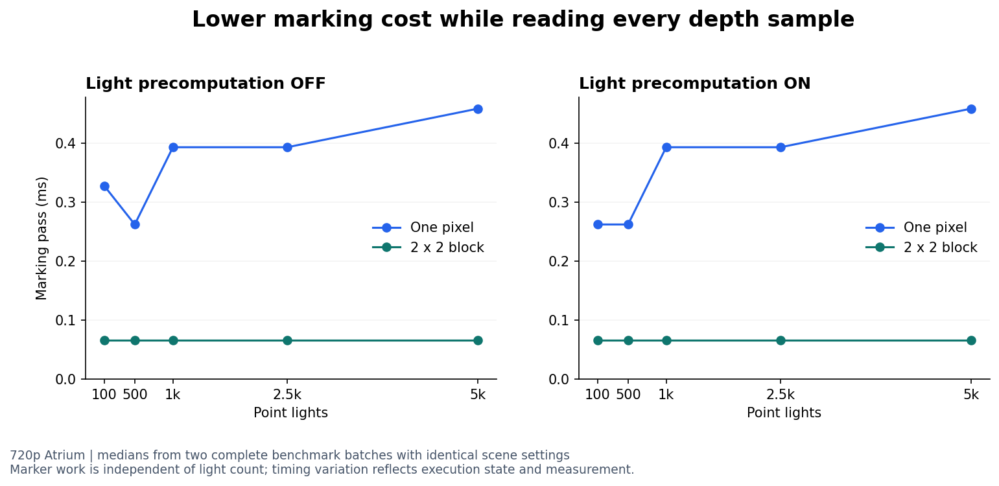

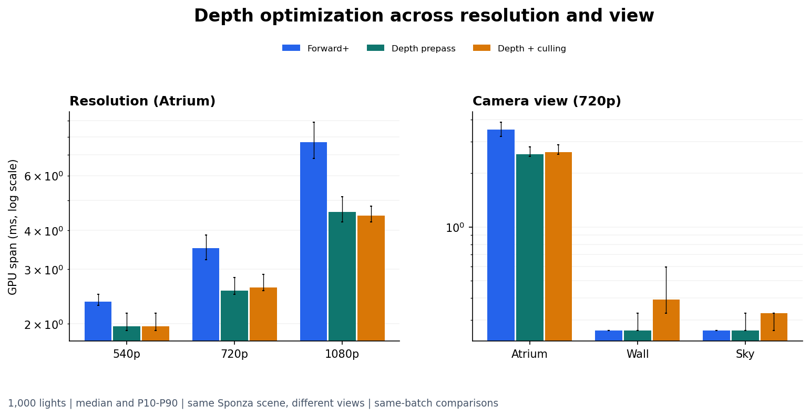

### Optimization: compute lighting and G-buffer compression

The final deferred-layout experiment measures all four retained paths together. Median **GPU span**, light precomputation off:

| Workload | Raster32 (ms) | Compute32 (ms) | Packed16 (ms) | Packed8 + depth (ms) |
| --- | ---: | ---: | ---: | ---: |
| 720p, 100 lights | 1.376 | 1.376 | 1.180 | 1.114 |
| 720p, 1,000 lights | 3.604 | 3.670 | 3.408 | 3.342 |
| 720p, 5,000 lights | 8.126 | 11.272 | 11.338 | 10.682 |
| 540p, 1,000 lights | 1.704 | 2.392 | 2.359 | 2.294 |
| 1080p, 1,000 lights | 6.423 | 7.078 | 6.357 | 5.833 |

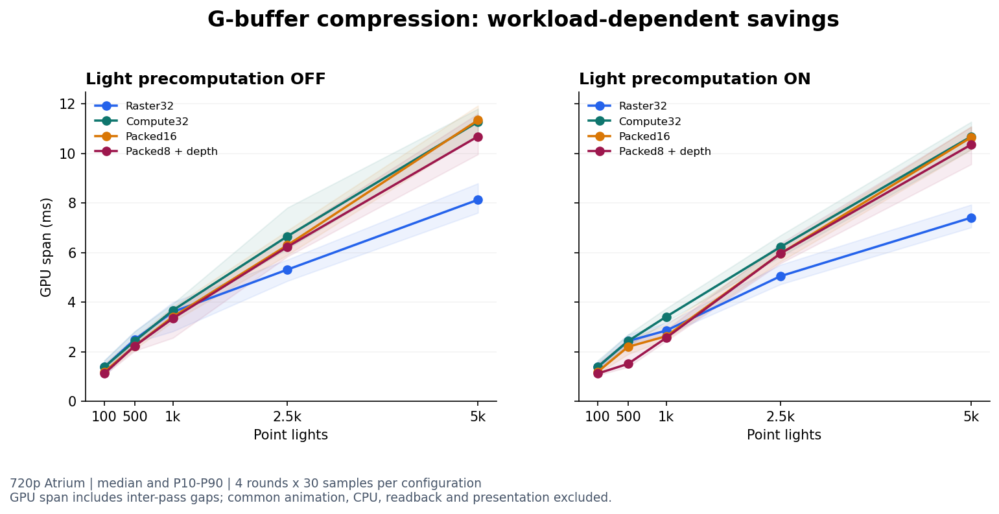

At 1080p/1,000 lights, Packed8 reduces time by **8.2% versus Packed16** and **9.2% versus Raster32**. At 720p/1,000 lights the extra gain over Packed16 is only 1.9%, or one timer step. At 5,000 lights, Packed8 improves on Packed16 by 5.8% but is still **31.5% slower than Raster32**. At 540p/1,000 lights it is 34.6% slower than raster.

The largest observed Packed8-versus-Packed16 reduction is 31.3% at 720p/500 lights with precomputation **on**. With it off, that workload's medians are equal, and sample ranges overlap; the 31.3% should not be treated as a general compression speedup. Across the tested pairs, the additional reduction ranges from 0 to 31.3%.

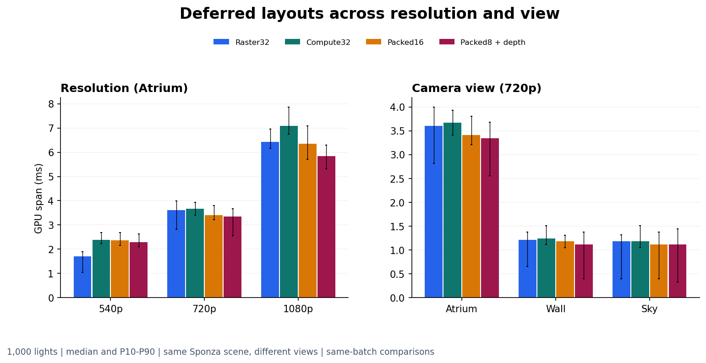

Compression reduces nominal attachment traffic, but adds normal/color decoding, position reconstruction, and depth storage/reads. Higher resolution increases the potential value of reducing per-pixel storage. At high light counts, lighting arithmetic remains substantial; compute execution can still lose to raster. No bandwidth or occupancy counters were collected, so cache, scheduling, and frequency effects cannot be separated from format savings. Raster remains the default; Packed16 offers higher precision, while Packed8 prioritizes storage.

Further experiments could investigate workgroup light sharing, different workgroup/grid sizes, and material formats adapted to HDR input. Their costs and image errors would need separate measurement.

### Precision and correctness

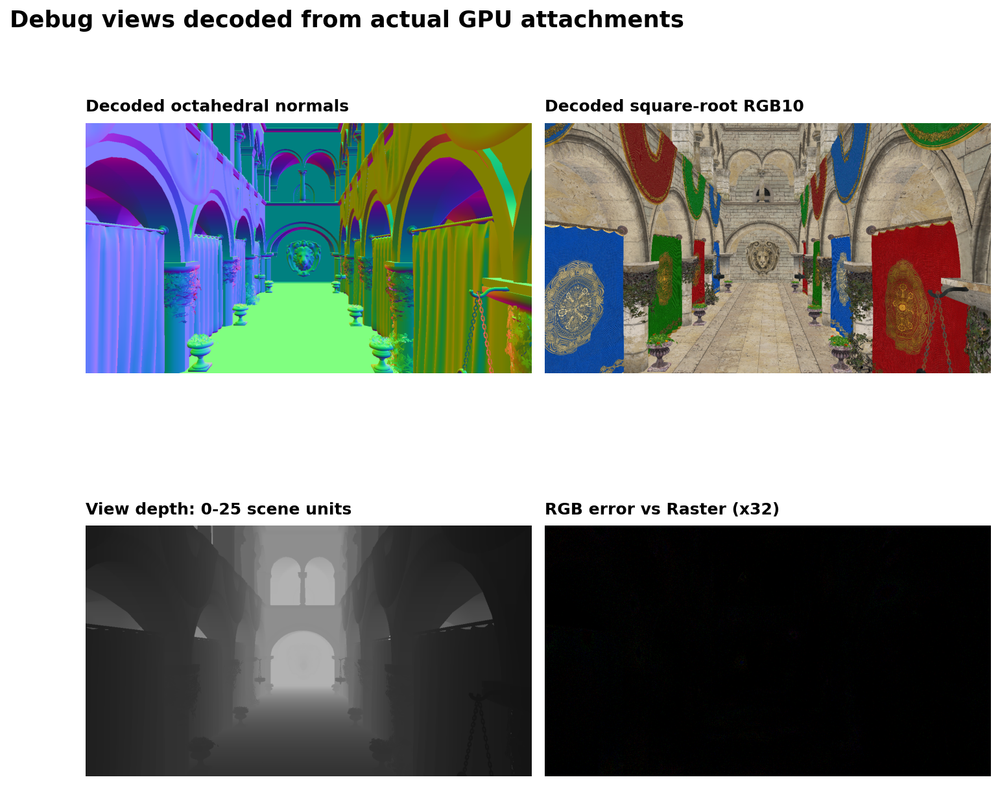

*Offline debug captures of actual GPU attachments: decoded normals, albedo, view depth, and a difference image amplified 32×. These are validation assets, not an additional live UI mode.*

The final regression covers **19 scenes/settings × 10 configurations**, including 0–5,000 lights, moved cameras, changed seed/time, Sky/background, 540p/720p/1080p, an odd 1279 × 719 resolution, and six additional moving-camera/time samples.

- Forward+ depth/culling regression matches Naive exactly in these tests. Compute32 matches Raster32 exactly. Light precomputation does not change any variant's pixels.
- Alpha and background coverage agree throughout. Earlier culling validation also passed **72 GPU depth-boundary cases** with no missed visible clusters.
- Packed16's maximum difference in the expanded tests is 2/255. Packed8's typical 720p/1,000-light maximum is 2/255; across all tests its maximum is **7/255 versus Naive** and **8/255 versus Raster**.
- Packed8's worst mean RGB error is **0.061565/255**. The largest fraction of pixels differing by more than 1/255 is **0.0115%**. These are observed errors, not guarantees for arbitrary scenes.
- GPU position-reconstruction diagnostics find a maximum error of about **0.000713 scene units** across three tested views. Small position and albedo errors can be amplified near bright lights.

Square-root RGB10 improves precision for dark materials compared with linear quantization. The recorded checks use a 16/255 maximum-error ceiling, mean error below 0.1/255, and fewer than 0.1% of pixels above 1/255. These thresholds evaluate lossy compression; Packed16 or the baseline provides higher precision, and HDR albedo requires another encoding.

Validation covers type checking, production builds, shader compilation, GPU validation, resize/variant changes, resource cleanup, paused redraw, benchmark cancellation/restoration, and simulated optional-feature fallbacks. Recorded [image-quality results](benchmarks/data/image-quality.json) and [active-cluster flags](benchmarks/data/active-clusters.json) accompany the performance data.

## Reproduce the measurements

1. Run the application, set **Seed = 123456789**, and use **Reset fixed scene** to pause lights at 2,500 ms. Pause rendering in other project tabs.
2. Open **Benchmark**. Use `full` for the baseline comparison (3 rounds), or `depth prepass`, `depth culling`, or `g-buffer` (4 rounds).
3. Set **Warmup frames = 12**, **Samples per round = 30**, then run. The suites choose their own comparison configurations; they do not just measure the currently selected renderer.
4. Keep the page visible. Export JSON for metadata and all samples, or CSV for per-configuration summaries. Cancel restores the prior scene/settings.
5. Compare same-batch medians and sample spread. Each suite sets its own cameras, resolutions, and renderer variants, and restores the previous scene after completion or cancellation. Results depend on the GPU, browser, drivers, and system load.

The repository includes the measured samples and an independent analysis script. To regenerate all ten charts and six CSV summaries, use **Python 3.10–3.12**:

```sh
python -m pip install -r benchmarks/requirements.txt
python benchmarks/analyze.py
```

Generated figures, verified summaries, and `validation.json` are written to `output/benchmark-analysis/`. The script checks archive hashes and recomputes the reported statistics from **36,450 raw samples**. It also accepts a newly exported benchmark:

```sh
python benchmarks/analyze.py --input path/to/export.json --out output/my-run
```

This command validates the export and writes `summary.csv`. See the [benchmark guide](benchmarks/README.md) for experiment metadata, optional virtual-environment setup, and timing definitions. The archived measurements reproduce the published charts; a fresh browser run measures the current machine.

## Data and project structure

| Experiment | Raw samples (compressed JSON) | Verified summary |
| --- | --- | --- |
| Baselines + light transforms | [Data](benchmarks/data/baselines.json.gz) | [CSV](benchmarks/summaries/baselines.csv) |
| Depth prepass | [Data](benchmarks/data/depth-prepass.json.gz) | [CSV](benchmarks/summaries/depth-prepass.csv) |
| Depth culling, one-pixel marker | [Data](benchmarks/data/depth-culling-per-pixel.json.gz) | [CSV](benchmarks/summaries/depth-culling-per-pixel.csv) |
| Depth culling, 2 × 2 marker | [Data](benchmarks/data/depth-culling.json.gz) | [CSV](benchmarks/summaries/depth-culling.csv) |
| Raster, compute, and Packed16 | [Data](benchmarks/data/deferred-packed16.json.gz) | [CSV](benchmarks/summaries/deferred-packed16.csv) |
| All four deferred variants | [Data](benchmarks/data/deferred-packed8.json.gz) | [CSV](benchmarks/summaries/deferred-packed8.csv) |

The [experiment catalog](benchmarks/experiments.json) records capture dates, sample counts, timing metrics, and checksums. All figures use the bundled data.

- `src/stage/`: camera, scene, light data, and clustering dispatch.
- `src/renderers/`: naive, Forward+, and the four deferred variants.
- `src/shaders/`: WGSL clustering, visibility marking, lighting, and packing.
- `src/performance/`: reusable GPU timing and benchmark runner.
- `docs/images/`: screenshots, debug captures, and performance charts.
- `docs/demo/`: feature walkthrough, chapter player, and English transcript.
- `benchmarks/`: compressed raw measurements, readable summaries, and analysis tools.
- `scripts/`: portable static-asset packaging and documentation checks.

## Credits

- CIS 565 course starter code and the supplied Sponza scene; see [project instructions](INSTRUCTIONS.md). The scene loader, camera controls, light-motion compute shader, and naive shading originated in the starter. This project completes camera integration and implements the clustered pipelines and optimizations described above.
- Runtime/build dependencies retained from the starter: [Vite](https://vitejs.dev/), [loaders.gl](https://loaders.gl/), [dat.GUI](https://github.com/dataarts/dat.gui), [stats.js](https://github.com/mrdoob/stats.js), and [wgpu-matrix](https://github.com/greggman/wgpu-matrix).
- Documentation and validation tools: Playwright for browser automation/capture, FFmpeg for video recording, and Python/NumPy/Matplotlib/Pillow/OpenCV for offline analysis and media verification. These tools do not implement rendering features.
